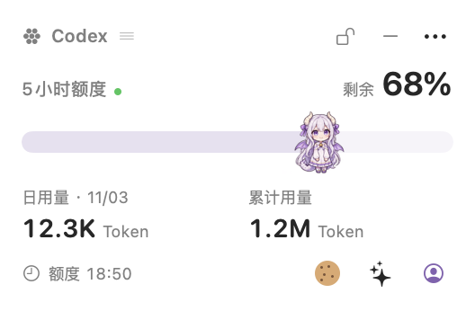
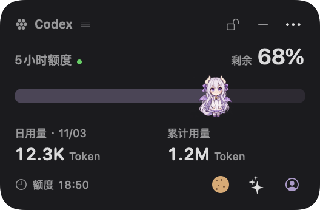
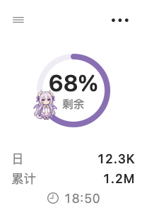
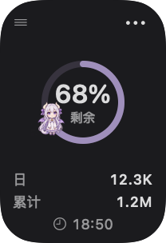
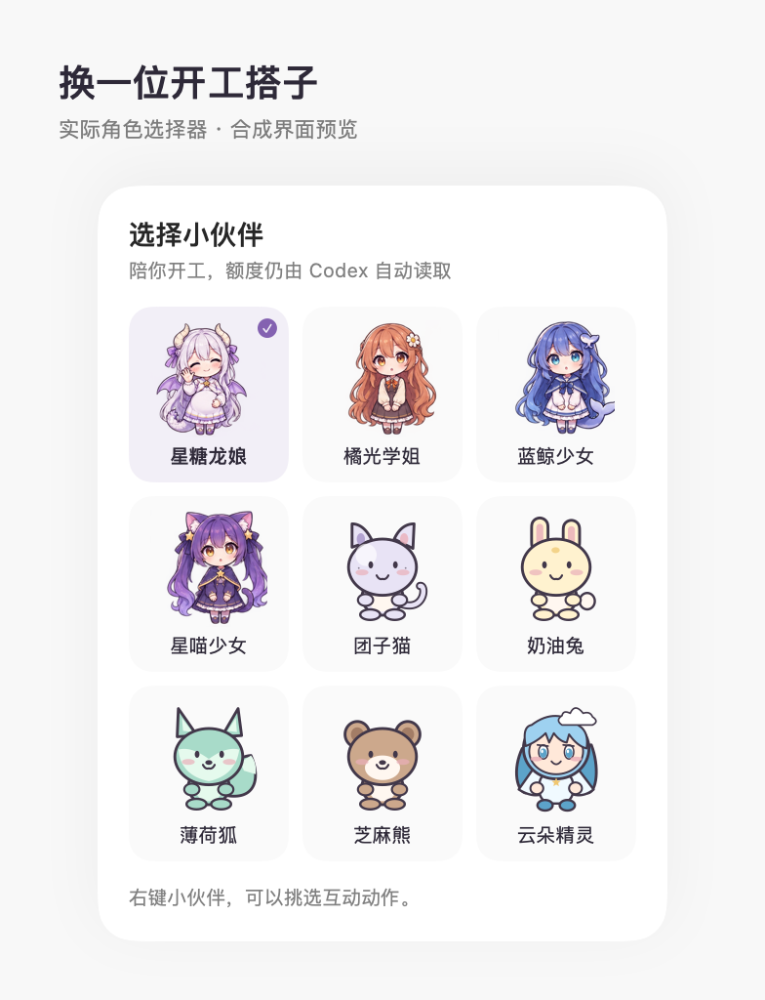

# Yuliang · 余量

A compact macOS companion for Codex quota and usage. Choose a 264-point card or a 104-point Duo ring. Your subscription quota, optional daily and lifetime Token statistics, and character share one state with the menu-bar popover. Appearance can follow the system or stay light or dark.

Choose one of four anime-style themes—Star Sugar Dragon Girl, Orange Glow, Blue Whale, or Star Kitty—or five original companions: Mochi Cat, Butter Bunny, Mint Fox, Sesame Bear, and Cloud Sprite. Star Sugar is the default. When a newer, verified quota observation shows consumption, your buddy eats a biscuit and follows the progress bar. Eight interactions include patting, waving, napping, cheering, feeding, jumping, swaying, and spinning. Play never changes quota or Token statistics.

[中文](README.md) · [Downloads](https://github.com/liny007915-debug/yuliang/releases) · [What's new](CHANGELOG.md)

**Separate licenses:** code and five original vector companions are MIT. The four anime themes require attribution and noncommercial use; Blue Whale follows CC BY-NC-SA 4.0 with attribution to both ZipZipPipe and 上善. The code license does not cover these character images. See [ASSETS.md](ASSETS.md).

## Synthetic previews

These native-interface previews use synthetic quota and Token statistics, not real account records. Character artwork retains the attribution and use conditions in [ASSETS.md](ASSETS.md).

| Light | Dark |
| --- | --- |
|  |  |

| Duo light | Duo dark |
| --- | --- |
|  |  |



## Install

Requires macOS 14 or later and an installed, signed-in official Codex CLI.

1. Open [Releases](https://github.com/liny007915-debug/yuliang/releases). Download `Yuliang-v0.14.0-macOS-arm64.zip` for Apple Silicon or `Yuliang-v0.14.0-macOS-x86_64.zip` for Intel, if that asset is available. Check **Apple menu → About This Mac** if unsure.
2. Extract the archive and move `余量.app` to `~/Applications` or `/Applications`.
3. Open the app. Collection starts automatically; the app has no Dock icon.

Downloads currently have an ad-hoc signature, not a Developer ID distribution signature or Apple notarization. If macOS blocks the first launch, verify that the file came from this repository and matches the Release's `SHA256SUMS`. Try opening it, then use **System Settings → Privacy & Security → Open Anyway**, and confirm **Open**. Managed devices may restrict this. See [Apple's instructions](https://support.apple.com/102445). Do not disable Gatekeeper or remove quarantine attributes.

Already using Codex? Do not reinstall it if Yuliang can read your account. If Homebrew is already installed, OpenAI documents this CLI installation method:

```sh
brew install --cask codex
codex login
```

Sign in with the ChatGPT account whose subscription quota you want to monitor. Yuliang reuses the CLI's login; if the CLI and desktop app use different accounts, the CLI account applies. API-key billing is a different quota scope. For other installation methods, use the [official Codex CLI guide](https://developers.openai.com/codex/cli/). Never share credentials or authentication files in an issue.

### Build locally

Requires Node.js 20+, Git, and Apple Command Line Tools. No npm runtime dependencies or full Xcode installation are needed. Check `xcode-select -p` and `xcrun swiftc --version`; run `xcode-select --install` only if the tools are missing.

```sh
git clone https://github.com/liny007915-debug/yuliang.git
cd yuliang
npm run build:mac
npm run install:mac
open "$HOME/Applications/余量.app"
```

The build produces `releases/余量.app` for the current machine's architecture and signs it ad hoc. The installer copies it to `~/Applications`, checks bundle identity and signature integrity, and attempts rollback if replacement fails. It does not quit or restart an existing process; quit the old version before opening the update. Local signing is not Developer ID certification or notarization.

## Use

- Click **余 N%** in the menu bar to open the popover.
- The desktop card is freely movable by default: drag its header, Duo's top grip, or non-interactive areas. Buttons and the character retain their click actions. Use the header's lock/unlock button or **锁定位置** in settings to fix or release its position. Position and lock preference are saved locally.
- Set always-on-top or desktop-level placement separately in the settings menu. Always-on-top and position locking are independent.
- The minus button, or **收起桌面卡片** in settings, hides only the desktop widget. Duo uses the settings option. Background collection continues; show it again or explicitly move it back to the current screen from the popover. This menu action can reposition a locked card.
- Use the character button to choose the four anime-style themes or five original companions. Your choice is saved locally.
- Choose **轻巧卡片** or **Duo 圆环** under **小组件样式** in settings. The compact card uses a 12-point rail with a 36-point character. The Duo ring, percentage, and moving character use the same quota value; it does not invent battery or network readings. The choice is saved locally, and switching keeps the window position.
- Duo uses a 20-point monochrome menu-bar ring. Click it to open the complete card; hide the desktop widget to use the menu-bar entry alone.
- Daily and lifetime Token usage are both shown by default. Toggle **日 Token 用量** and **累计 Token 用量** independently under **显示内容** in settings. The card uses one row; Duo uses two narrow rows that collapse independently. Hover or open details for the server's daily date and full numbers. These switches control display only.
- Select system, light, or dark appearance under **外观**. Appearance and display preferences are saved locally.
- Click the character for a random reaction. Right-click, open the bottom sparkle menu, or choose **互动** in settings for eight actions: pat, wave, nap, cheer, feed, jump, sway, or spin. Choose a character through the character button or **选择小伙伴** in settings. Play does not change quota, Token statistics, timestamps, or quota-derived satiety.
- Choose **Settings → 立即刷新** to read immediately; the details window also offers refresh. Open **用量与额度详情** in settings for independent endpoint status and success times, quota windows, statistical scope, and pause/resume controls. Persistent hints and picker instructions are folded away.
- Quit Yuliang from its menu to stop collection. Sleep pauses requests; waking resumes them.

Motion respects the macOS Reduce Motion setting. There is no audio or perpetual animated idle loop.

Locking, unlocking, changing the window level, and hiding the card do not change the target of starting a quota read every 60 seconds. Locking prevents dragging; explicitly choosing the menu action to move the card to the current screen still repositions it.

The four themes use ChatGPT dragon-girl, Claude orange-haired senior-student, DeepSeek blue-whale-girl, and Gemini star-cat-girl directions, with new six-frame artwork made for the quota bar. The artwork is an AI-assisted adaptation of the designs documented by the community [llm-pet](https://github.com/savanna0425/llm-pet) project, redrawn into six frames for this quota card. The original attribution and artwork conditions remain in place. They are unofficial appearances, not official model-company characters. Character themes do not change the data provider: choosing the Claude or DeepSeek theme does not connect that service. This release reads Codex quota and Token usage only. See [ASSETS.md](ASSETS.md) for attribution and artwork rights.

## What the numbers mean

Yuliang reads subscription quota through `account/rateLimits/read` from the official local `codex app-server`. It does not create conversations or run model tasks. The rail shows account-shared Codex percentages, windows, and reset times separately from Token usage; it does not convert quota percentages into Token counts, API credits, or ordinary ChatGPT conversation limits.

The target request-start interval is 60 seconds. Slow requests, network errors, rate limits, sleep, and upstream delays can extend the interval. A biscuit plays once after a saved, newer observation confirms a decrease in the same window and known reset cycle. Initial loads, duplicates, unknown values, window switches, and resets do not count as consumption. Opening the popover does not replay an event.

Unknown stays unknown. Failed reads keep the last successful value and time. Reaching a reset timestamp does not invent a full balance; the next valid observation must confirm it.

## Token usage

The separate read-only `account/usage/read` endpoint supplies Token statistics:

- **Daily · MM/DD** shows the latest statistical day and its count returned by the server. The server does not specify its timezone, so this is not local “today”; the date can differ from your Mac's current date.
- **Lifetime** shows the server's `lifetimeTokens` directly. It does not correspond to a subscription-quota window, remaining usable Tokens, or a monetary balance.

The card uses compact numbers; hover or open details for full values. Quota and Token endpoints have independent status and success timestamps. Missing, unsupported, or failed statistics do not become zero or borrow the other endpoint's success time. Both share the 60-second target collection cycle, and upstream statistics may be delayed. Token changes do not trigger or replay the quota-consumption biscuit event.

## Privacy

Yuliang does not directly read Codex authentication files, passwords, cookies, API keys, or conversation content. The official CLI manages authentication and its requests to OpenAI. Only allowlisted quota and account-usage summary fields are retained; thread records, identity fields, and unknown fields are discarded. Usage Tokens are not authentication tokens. Yuliang runs no analytics or cloud-sync service.

Quota and character preferences are stored at:

```text
~/Library/Application Support/YuliangStandalone/quota.json
```

Token statistics and their read status stay in process memory only and are fetched again after restarting; they are not written to the file above. Window placement, position lock, widget style, both Token display switches, appearance, and other display preferences are stored through macOS preferences. No real account records or credentials are included in the repository or release archives.

If Token statistics are unsupported or missing, values remain unknown and quota keeps its independent result. A failed Token read retains its previous in-memory value and original success time. A restart clears that in-memory value until the next successful read. The daily server date is not converted into your local calendar day.

If Codex cannot be found, check its installation location. Common supported paths include `/opt/homebrew/bin/codex`, `/usr/local/bin/codex`, `~/.local/bin/codex`, `~/.npm-global/bin/codex`, and known official app bundles. Custom npm/nvm paths may not be detected. If login fails, run `codex login` and retry from the details window; do not copy authentication files.

This release is a standalone Mac card and menu-bar app, not a WidgetKit system widget. iPhone support, cloud sync, and embedding inside the native Codex interface are not included.

To uninstall, quit the app and remove `余量.app`. Optionally remove the `YuliangStandalone` data directory above; this permanently deletes your local records and character choice. It does not remove Codex login state.

## Develop

```sh
npm run check
npm test
npm run check:codex
npm run check:mac-ui
npm run build:mac
npm run release:mac
```

Tests use synthetic observations and temporary storage. UI checks briefly open only their own AppKit surfaces and require a logged-in graphical macOS session. Release packaging produces an architecture-specific zip and `SHA256SUMS`; it does not perform Apple distribution signing or notarization.

See [CONTRIBUTING.md](CONTRIBUTING.md), [SECURITY.md](SECURITY.md), and [CHANGELOG.md](CHANGELOG.md).

## License

Code and five original vector companions use the [MIT License](LICENSE). The four anime themes retain attribution to ZipZipPipe and are limited to noncommercial use. Blue Whale also adapts 上善's whale design and follows CC BY-NC-SA 4.0, with attribution to both artists and ShareAlike for adaptations. Provenance and full artwork conditions are documented in [ASSETS.md](ASSETS.md); the code license does not replace artwork permissions. Old private-prototype third-party character atlases are not included; legacy IDs support preference migration and do not grant rights to distribute those characters.

Yuliang is an independent community project, not an official OpenAI or character-brand product. Third-party marks belong to their respective owners; the MIT License does not grant rights to those marks or characters.

Official references: [Codex CLI](https://developers.openai.com/codex/cli/), [Authentication](https://developers.openai.com/codex/auth/), [App Server](https://developers.openai.com/codex/app-server), [Apple app security](https://support.apple.com/102445).
