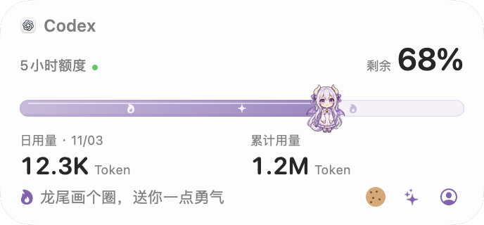
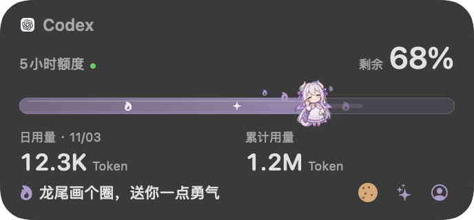
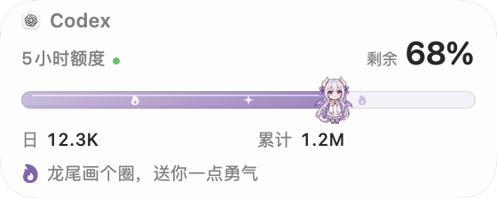
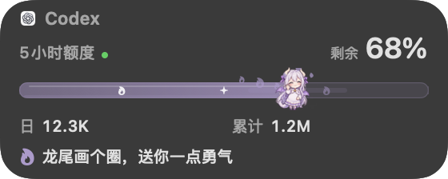
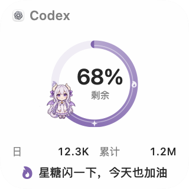
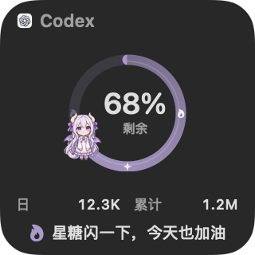
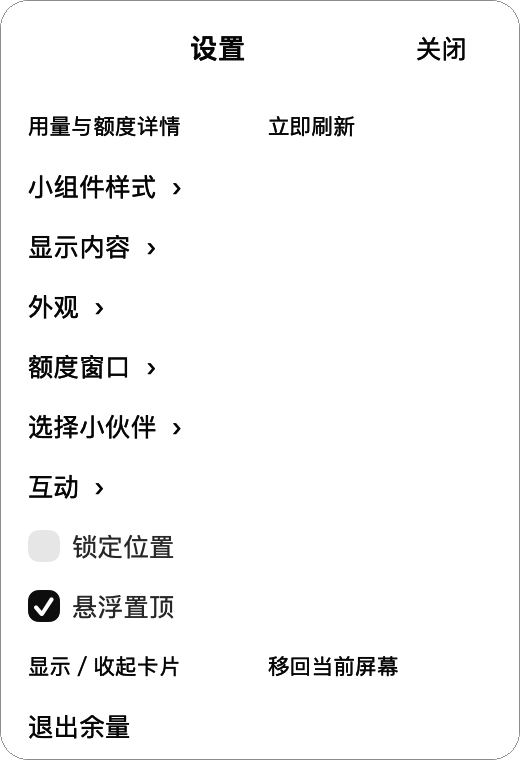
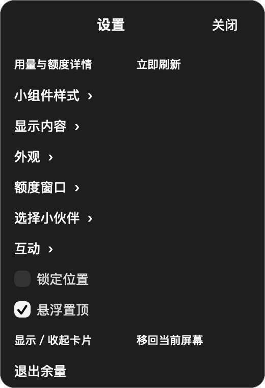

# 余量 Yuliang

一个紧凑的 Mac AI 用量伙伴。v0.17.1（build 24）可选择 Codex 或 Claude 订阅额度，提供 344 × 160pt 标准卡片、280 × 112pt 紧凑卡片与 160 × 160pt Duo 外框。Duo 内部圆环和人物适度放大，外框不增加。Codex 的日 Token 与累计 Token 可独立显示；Claude 没有提供的 Token 不推算。菜单栏弹出卡随紧凑开关调整，额度与互动状态和桌面同步。界面支持简体中文、English、日本語及跟随系统；明暗外观也可跟随系统或手动选择。

角色与动作支持星糖龙娘、橘光学姐、蓝鲸少女、星喵少女、云朵精灵、奶龙和持剑小猫，默认星糖龙娘。v0.17.1 公开 App 与源码包含全部七位的对应形象和动作；插件 ZIP 不带图集，使用本机 App 资源。真实额度减少时，小伙伴会吃一块饼干，再沿进度条挪动一点。保留十二种通用互动，并为每位角色提供自己的招牌动作、短句与视觉回应。团子猫、奶油兔、薄荷狐和芝麻熊已退出选择器，旧偏好仍可迁移。互动不修改真实额度或 Token 统计。角色来源与使用条件见 [ASSETS.md](ASSETS.md)，不代表官方授权或联名。

紧凑卡片将字号、轨道与 Token 行一起收拢，窗口真实缩小。新版进度条以柔和高光、少量主题符号与珠点保留装饰，减少密集刻度的机械感；悬停与点按反馈随角色变化，人物继续贴合真实额度端点。点按触发人物回应，不调整额度。自主陪伴开启时，人物在约 30 秒（26–34 秒）的安静间隔后自己动一动，送上专属本地关怀短句；可在「设置 → 显示内容 → 自主陪伴」关闭。

平时显示一句鼓励，成功接收较新额度后短暂显示更新时间，约 2.4 秒后恢复；互动后的对应鼓励保留约 5.5 秒。读取异常和需要处理的状态优先显示。标准卡片与 Duo 使用 22pt 连续圆角，紧凑卡片使用 20pt，搭配原生窗口材质与语义文字颜色。浅色卡片加入 94% 白色表层，菜单、设置和角色选择统一白底；深色继续使用原生材质。模式缩放约 0.36 秒，外观、角色、语言、显示内容及设置页面有短过渡；启用系统「减少动态效果」时省略运动。右键打开的设置面板始终可连续选择。它是独立原生桌面浮窗，不是 WidgetKit 系统组件，系统材质实际效果会随后方内容与系统设置变化。

[English](README.en.md) · [下载](https://github.com/lin52001/yuliang/releases/tag/v0.17.1) · [本次改进](RELEASE-v0.17.1.md) · [更新记录](CHANGELOG.md) · [交互参考与来源](PROGRESS-INTERACTION-REFERENCES.md) · [系统外观核查](apple/MACOS-WIDGET-APPEARANCE.md) · [Codex 插件](docs/YULIANG-PLUGIN.md)

**许可分开看**：代码采用 MIT；角色图集、角色设定与官方产品标识按各自来源及使用条件处理，代码许可不覆盖第三方图像与商标，见 [ASSETS.md](ASSETS.md)。

## Codex 本地插件试验版

[下载插件 ZIP](downloads/Yuliang-Plugin-v0.1.0-beta.2.zip) · [SHA256 校验](downloads/Yuliang-Plugin-v0.1.0-beta.2.sha256)

`0.1.0-beta.2` 提供额度与 Token 查询、刷新、显示卡片、人物互动、换角色，以及布局、明暗和语言设置。最低兼容本机余量 `0.17.0` build `23`，本次配套 App 为 `0.17.1` build `24`；还需 Node.js 20+ 与支持插件的 Codex。插件共用现有约 60 秒采集，不打包 App 或人物图片；小人物仍显示于余量原生卡片。安装、使用与远程市场更新命令见 [插件指南](docs/YULIANG-PLUGIN.md)。beta.2 修复自动启动异常被误报为未安装的问题，先连接运行中的 App，再按需尝试启动。已有兼容 App 时，仅修复插件连接无需重装 App；体验新视觉才需更新 App。自动启动失败时可先手动打开现有余量并保持运行。

## 合成演示（v0.17.1）

以下为 v0.17.1 原生界面验收导出的合成预览，使用合成额度和 Token，不是真实账号数据。标准、紧凑、Duo 与连续设置来自同一测试版本，展示本版装饰进度条与放大后的 Duo 圆环和人物；预览统一使用星糖龙娘。窗口缓存不完整反映屏幕材质与单色合成，也不证明 Claude 真实账号已读取。角色来源与使用条件见 [ASSETS.md](ASSETS.md)。

| 浅色 | 深色 |
| --- | --- |
|  |  |

| 紧凑浅色 · 280 × 112pt | 紧凑深色 · 280 × 112pt |
| --- | --- |
|  |  |

| Duo 浅色 | Duo 深色 |
| --- | --- |
|  |  |

设置采用独立小面板，修改后保持打开，可连续选择，再点关闭。

| 设置浅色 | 设置深色 |
| --- | --- |
|  |  |

## 安装

需要 macOS 14 或更新版本。使用 Codex 数据源时，需要这台 Mac 上已经安装并登录的官方 Codex CLI；使用 Claude 数据源时，在余量的连接窗口完成 Claude 官网登录。无需 Apple Developer 账号；应用不要求粘贴密码、Cookie 或 API 密钥，Claude 的密码和验证码只在官网页面填写。

### 下载应用

1. 打开 [Releases](https://github.com/lin52001/yuliang/releases)，选择对应芯片的安装包。

   | Mac 类型 | 文件名 |
   | --- | --- |
   | Apple Silicon，M 系列芯片 | [`Yuliang-v0.17.1-macOS-arm64.zip`](https://github.com/lin52001/yuliang/releases/download/v0.17.1/Yuliang-v0.17.1-macOS-arm64.zip) |
   | Intel | [`Yuliang-v0.17.1-macOS-x86_64.zip`](https://github.com/lin52001/yuliang/releases/download/v0.17.1/Yuliang-v0.17.1-macOS-x86_64.zip) |

   可在「苹果菜单 → 关于本机」查看芯片类型。只下载 Release 实际提供的文件；没有对应芯片的包时，请使用下面的源码构建方式。

2. 解压，将 `余量.app` 拖到个人「应用程序」文件夹 `~/Applications`，或系统「应用程序」文件夹 `/Applications`。
3. 打开应用。默认 Codex 数据源会自动尝试读取；Claude 需要先按下方步骤连接官网并开启自动读取。Dock 中不显示图标。

当前应用使用本机 ad-hoc 签名，没有 Developer ID 发行签名或 Apple 公证。从浏览器下载后，macOS 可能阻止首次打开。确认下载来自本仓库、文件校验符合 Release 提供的 `SHA256SUMS` 后，先尝试打开应用，再进入「系统设置 → 隐私与安全性」，找到本次阻止提示，选择「仍要打开」，并在确认框中选择「打开」。受组织管理的 Mac 可能不允许此操作。

不要关闭 Gatekeeper，也无需执行删除隔离属性的命令。Apple 的完整说明见 [安全打开 Mac 上的 App](https://support.apple.com/102445)。

### 还没有安装或登录 Codex？

如果已经安装官方 Codex，并且余量能够读取，跳过此步。只使用 Claude 数据源时也可跳过，直接按后文连接 Claude。

已安装 Homebrew 的用户可以按 OpenAI 官方提供的方法安装 CLI：

```sh
brew install --cask codex
codex login
```

`codex login` 会进入官方浏览器登录流程。为读取订阅额度，请使用对应 ChatGPT 账号登录；API 密钥计费与订阅额度不是同一口径。没有 Homebrew 时，按 [OpenAI 官方 Codex CLI 安装说明](https://developers.openai.com/codex/cli/) 选择适合自己的方式，不必为余量重复安装已经存在的 Codex。

余量复用 CLI 的已有登录。CLI 和桌面 App 使用不同账号时，以 CLI 账号为准。安装位置若不在余量支持的常见目录中，可能提示找不到 Codex；先到「额度详情」查看状态，并参考下方排查说明。请勿将认证文件或终端登录输出粘贴到 Issue。

### 从源码构建

需要 Node.js 20+、Git 和 Apple Command Line Tools，无需完整 Xcode，也没有需要下载的 npm 运行时依赖。

先检查工具：

```sh
node --version
xcode-select -p
xcrun swiftc --version
```

只有尚未安装 Command Line Tools 时，运行 `xcode-select --install`，并完成 Apple 的安装窗口。已有工具无需重复安装。

```sh
git clone https://github.com/lin52001/yuliang.git
cd yuliang
npm run build:mac
npm run install:mac
open "$HOME/Applications/余量.app"
```

构建结果为 `releases/余量.app`，安装脚本会将它安装到 `~/Applications/余量.app`。构建使用当前机器架构，不把单架构包标为 Universal。脚本会检查应用标识与签名完整性，拒绝覆盖同名的其他应用；替换失败时尝试恢复旧版。安装脚本不会自动结束已运行的余量或替你启动新版本，更新后请先退出旧版，再打开已安装的新版本。

源码构建使用本机 ad-hoc 签名。它能验证本地包的一致性，但不等于 Apple 的 Developer ID 认证或公证。

## 怎么用

- **查看额度**：看桌面卡片，或点击菜单栏的「余 N%」。Duo 模式的菜单栏使用圆环小图标，点击后同样打开完整卡片。两个入口共用同一份状态与采集器。
- **切换额度来源**：在「设置 → 额度来源」选择 Codex 或 Claude，也可在用量详情顶部切换。两个来源分别保存额度与状态，不把一个来源的读数当成另一个来源的数据。切换角色外观不会切换额度来源。
- **打开设置**：右键或按住 Control 点击桌面卡片，打开稳定设置面板；人物区域的右键仍打开互动动作面板。桌面右上角不再常驻锁定、收起或设置按钮。菜单栏弹出卡保留「设置」及显示桌面入口，隐藏或锁定卡片后也能找回。
- **切换样式**：在「设置 → 小组件样式」选择标准卡片（344 × 160pt）、紧凑卡片（280 × 112pt）或 Duo 圆环（160 × 160pt）。紧凑开关真实改变卡片和菜单栏弹出卡尺寸，Token 行与快捷入口同步收拢；Duo 尺寸不受该开关影响。标准与 Duo 圆角为 22pt，紧凑为 20pt。切换有短缩放与淡入淡出，保留左上位置并约束在屏幕内；设置面板保持打开。填充、百分比和人物端点仍共用同一真实额度值。
- **摆放卡片**：默认可以自由拖动桌面卡片，标题与非交互区域可拖动；按钮和人物保留各自的点击操作。右键打开设置后用「锁定位置」锁定或解锁。卡片位置和锁定偏好会保存在本机。
- **悬浮置顶**：在设置面板中单独切换悬浮置顶或贴在桌面。置顶与位置锁定互相独立，锁定位置不会改变卡片所在层级。
- **收起卡片**：选择「设置 → 收起桌面卡片」，只隐藏桌面窗口，后台继续读取。可在菜单栏弹出卡中重新显示或主动移回当前屏幕；即使已经锁定位置，也能使用菜单的移回操作。
- **切换角色**：点击标准卡片的角色按钮，或选择「设置 → 选择小伙伴」，可选择全部七位角色，包括奶龙与持剑小猫的形象及动作。紧凑卡片通过右键进入角色选择。选择保存在本机，并同步到菜单栏卡片。
- **选择 Token 显示项**：默认显示日用量与累计用量。在设置面板的「显示内容」中，分别切换「日 Token 用量」和「累计 Token 用量」；卡片中并排展示，Duo 中分为两条窄行，关闭后仅收起对应内容，外框尺寸不变。Duo 的「日」值沿用服务端统计日，悬停或详情可查看日期。开关只控制显示，读取节奏不变。
- **切换语言**：打开「设置 → 语言」，选择跟随系统、简体中文、English 或日本語。文字、日期和数字即时更新，设置页继续保持打开，语言偏好保存在本机。切换不改写额度记录或官网页面语言。
- **切换外观**：在设置面板的「外观」中分别选择深浅外观（跟随系统、浅色、深色）和桌面色彩（「自动 · 后台淡为单色」「始终全彩」「始终单色」）。自动模式采用本机前台应用信号：Finder 或余量在前台时全彩，其他应用在前台时淡为单色；这是桌面焦点的近似处理，Finder 文件窗口也会被归为全彩。桌面材质采用 `underWindowBackground` 与 `behindWindow` 随后方内容融合。尚不能自动读取系统 Clear/Tinted 的具体选择，应用色彩选项与系统小组件设置不双向同步，也不保证逐像素一致。偏好保存在本机。
- **和小伙伴玩**：点击人物随机回应，右键、标准卡片底部闪光按钮或「设置 → 互动」可选择十二种通用动作与当前角色的专属动作。龙娘的龙息星糖、学姐的暖光应援、蓝鲸的泡泡跃浪、星喵的星轨巡游、云朵的轻飘、奶龙的弹弹肚皮与小猫的护你一剑拥有各自回应。点按额度轨道也能互动；娱乐不改变额度、Token、时间戳或长期饱腹状态。
- **自主陪伴**：开启后，人物在约 30 秒（26–34 秒）的安静间隔后伸懒腰、探头、撒娇或邀请一起喝水，不需要每次都点击。手动互动和真实额度进食优先，动作结束后保留短暂安静；持续每分钟产生新消耗也不会把自主陪伴一直重新延期。隐藏、休眠、操作设置或开启系统「减少动态效果」时暂停自主动作，不排队补播。关闭「设置 → 显示内容 → 自主陪伴」可保留手动互动并停止自主陪伴。关怀只依据本机可见会话的计时，不读取聊天或判断你的情绪。
- **查看鼓励与刷新反馈**：平时显示鼓励语；成功接收较新额度后，更新时间只短显约 2.4 秒，完整时间保留在悬停提示与详情。手动互动显示对应鼓励约 5.5 秒，优先于刷新提示；已经过期的刷新提示不会在互动结束后补播。读取失败、未登录、未知、陈旧或重置待核对等状态优先显示。互动、角色切换和显示开关都不改变组件外框。
- **手动读取与排查**：选择「设置面板 → 立即刷新」，详情中也可刷新。设置面板中的「用量与额度详情」显示两个接口各自的状态和成功时间，以及额度窗口、统计口径和暂停/继续入口。常驻提示与角色选择说明已收起。
- **退出**：在更多菜单中选择「退出余量」，后台读取随之停止。

界面不播放声音，遵循 macOS「减少动态效果」偏好。自主动作只改变短暂视觉反馈，不持续扣减或模拟真实额度。

位置锁定、解锁、置顶和收起卡片都不改变后台每 60 秒开始读取一次的目标节奏。锁定只防止拖动，菜单中明确选择的移回当前屏幕仍会重新摆放卡片。

四位拟人主题分别对应 ChatGPT 的龙娘、Claude 的橙发学姐、DeepSeek 的蓝鲸少女和 Gemini 的星星猫娘方向，依照 [llm-pet](https://github.com/savanna0425/llm-pet) 介绍的设定进行 AI 辅助重绘，并为额度条重新制作六帧图集。原设定与重绘改编的署名及素材条件一并保留。它们是非官方外观主题，不是模型公司官方角色。角色主题与数据源分开：选择橘光学姐不会连接 Claude，选择蓝鲸少女也不会连接 DeepSeek。当前数据源为 Codex 的额度与 Token 使用统计，以及需单独官网登录的 Claude 可见订阅额度；图像来源与权利范围见 [ASSETS.md](ASSETS.md)。

## 连接 Claude 额度

1. 打开「设置 → 额度来源 → 连接 Claude 官网」，进入应用内的连接窗口。
2. 在窗口下方的 Claude 官网完成登录与验证。Google 等官网登录方式会打开独立的官网登录子窗口；完成后返回余量的连接窗口，点击「前往额度页」，进入 **Settings → Usage**，即 `claude.ai/settings/usage`。密码和验证码只填在官网页面或该官网登录子窗口，不粘贴到余量、终端或 Issue。
3. 登录子窗口结束、额度页显示账号额度后，点击「开始 60 秒刷新」。首次手动读取也可使用「立即刷新」；需要停止时点击「暂停自动读取」。关闭连接窗口不会停止已经开启的自动读取，退出余量则停止。
4. 在「额度来源」选择 Claude，查看官网实际提供的当前会话、每周或模型额度窗口。没有显示的窗口、百分比或重置时间保持未知，不按套餐推算。

Claude 连接使用应用内 WebKit 登录会话，仅读取额度页可见的额度文字与重置时间，不导入其他浏览器 Cookie、不导出认证令牌，也不读取聊天内容。官网只提供额度时不会推算 Token 数量，也不会借用 Codex 的 Token 统计。两个来源的记录与错误状态分别处理。

官网可能限制内嵌浏览器登录，或因页面结构、语言、网络和限流而无法读取。可用「打开官网」在默认浏览器核对；外部浏览器登录不会自动同步到应用内连接窗口，不能把外部已登录视为连接成功。失败时保留上次记录，并显示实际状态。

**验证边界**：Claude 连接入口已开放，官网登录回跳已验证；官网转套餐页时不采样，账号可显示 Usage 额度后再开启读取。解析与刷新采样仍通过隔离合成页面验证，尚未在可显示额度的账号上完成端到端验收，不能保证所有账号和官网页面版本都可读取。实际额度接通以界面的最新成功时间与官网读数一致为准。60 秒是目标采样间隔，网络、官网验证、退避和休眠可能使间隔更长。

## 额度和饼干怎样对应

余量通过本机官方 `codex app-server` 的只读 `account/rateLimits/read` 方法读取账号共享的 Codex 订阅额度，不创建聊天或发起模型任务。额度条展示接口返回的百分比、窗口长度及重置时间，与下面的 Token 使用统计分开，不据此反推 Token 数量或 API 余额。

目标每 60 秒开始一次查询。请求尚未完成、网络错误、限流或电脑休眠时，实际间隔可能更长；服务端统计也可能有延迟。可以手动立即读取，限流退避期间仍需等待。

每次成功保存的新采样确认同一额度窗口、同一已知重置周期的剩余比例下降时，角色吃一块饼干。两次读取之间不会自行扣减，初次加载、重复记录、切换窗口、未知比例和重置不会被当作新消耗。缺少可靠重置时间时也不会猜测进食。打开菜单栏卡片不会重复投喂。

未知数据保持未知。失败时保留上次记录，不把「未提供」补成零或 100%；重置时间到了会等待新读取确认，不自动回满。

## Token 用量怎样理解

以下 Token 统计仅适用于 Codex 数据源，通过独立的只读 `account/usage/read` 接口获取，不从订阅额度百分比估算；Claude 额度页未提供 Token 时不显示或推算这些数值：

- **日用量 · MM/DD**：服务端返回的最新统计日及该日 Token 数。服务端未注明统计时区，因此它不代表本地「今日」，统计日可能与本机当前日期不同。
- **累计用量**：直接展示服务端返回的 `lifetimeTokens`。它与当前额度窗口的百分比不对应，不表示还可以使用多少 Token，也不是计费金额。

卡片用紧凑数字显示，悬停或打开详情可查看完整值。额度与 Token 各自有读取状态和成功时间；某个接口失败、缺字段或不受支持，不会把另一接口的成功当成自己的新记录，也不会用零补齐未知。后台目标周期仍为 60 秒，服务端统计可能有延迟。Token 变化不会触发或重复播放真实额度进食。

## 隐私与保存

余量不直接读取 Codex 认证文件、密码、Cookie、API 密钥或聊天正文。官方 CLI 自行处理 Codex 登录和请求；余量只接收经过白名单整理的额度摘要与账号 Token 统计，丢弃线程记录、身份字段及未知字段。Claude 的登录会话由本机 WebKit 网站数据管理，余量仅读取官网额度页可见信息，不导入外部浏览器凭据或导出会话 Cookie。模型用量 Token 不等于认证令牌。应用不运行自己的分析遥测或云同步服务。

额度摘要和角色选择保存在本机：

```text
~/Library/Application Support/YuliangStandalone/quota.json
```

目录与文件分别使用本机访问权限保护；保存采用文件锁、校验与原子替换。Codex Token 统计及其读取状态由当前进程管理，不写入上述额度存档，重启后重新读取。插件查询会生成短时本机响应文件并把摘要返回当前 Codex 聊天；响应使用仅当前用户可读写的权限，调用完成后清理。窗口位置、位置锁定、置顶、小组件样式、紧凑模式、两项 Token 显示开关、自主陪伴、语言与外观偏好另外由 macOS 本机偏好系统保存。公开仓库与安装包不包含用户的真实额度、Token 统计或登录信息。

## 常见问题

**没有看到桌面卡片。** 点击菜单栏「余 N%」或「余量」，通过显示桌面卡片入口找回，也可主动移回当前屏幕。切换到贴桌面模式后，其他普通窗口可能遮住卡片；需要一直可见时，在设置面板中开启悬浮置顶。

**提示未找到 Codex。** 确认官方 Codex 已安装。当前会查找已知官方 App 内的 CLI，以及 `/opt/homebrew/bin/codex`、`/usr/local/bin/codex`、`~/.local/bin/codex`、`~/.npm-global/bin/codex` 等常见位置。自定义 npm/nvm 安装目录未必可被找到；`command -v codex` 可帮助确认位置。不要移动或复制认证文件。

**提示未登录或读取失败。** 在终端运行 `codex login`，完成官方登录后回到额度详情重试。若此前使用 API 密钥登录，订阅额度可能不适用。升级官方 Codex CLI 后也可重试。界面会保留上一次成功记录，不会伪造新的成功时间。

**余量已经运行，插件却提示 App 不可用。** 请按 [插件指南](docs/YULIANG-PLUGIN.md) 先更新远程市场，再安装 `0.1.0-beta.2`；随后重启 Codex 并开启新聊天。本机路径市场不执行远程市场升级。早期插件会把系统启动异常统一误报为 App 不可用；beta.2 先连接现有进程，并区分启动失败和无回应。已有 v0.17.0 build 23 或更新版本无需为了此修复重装，自动启动失败不等于 App 未安装。

**Claude 在浏览器里登录了，余量却没读到。** 应用内连接窗口及其官网登录子窗口与外部浏览器的登录会话独立。Google 等登录完成后，返回连接窗口点击「前往额度页」，确认 Usage 页显示额度后再开启刷新；若官网限制 WebKit 登录，请先用「打开官网」核对。当前尚未完成真实账号端到端验收，读取失败会保留未知或旧记录，不提供粘贴 Cookie 绕过方式。

**人物会自己动，能关掉吗？** 在「设置 → 显示内容」关闭「自主陪伴」。手动动作仍可使用；系统「减少动态效果」、休眠与组件隐藏也会抑制自主动作。陪伴不请求模型、读取聊天或修改真实额度。

**只有一个额度窗口，或另一个显示未知。** 以当前账号接口返回为准。余量不会假设每个账号都同时提供固定的 5 小时与 7 天窗口。

**Token 显示未提供，或日期不是今天。** 以当前 CLI 和账号接口返回为准；旧版 CLI 可能不支持统计接口，缺失数值保持未知。日用量使用服务端最新统计日，时区未注明，不换算成本地今日。Token 失败时保留进程内上一次成功记录和原时间，详情会显示独立状态。

**重启后 Token 读数为什么暂时消失？** Token 统计不写入额度存档，启动后需要重新读取；订阅额度摘要仍沿用原有本机存储。插件短时响应不是启动时恢复 Token 的数据源。

**用量改变了，角色却没有吃饼干。** 自动进食需要可信的同窗口、同重置周期、较新采样。未知、陈旧、重置或切窗口不会触发。短于接口百分比精度的消耗也未必立即可见。

**合上 Mac 后为什么不刷新？** 休眠期间暂停，唤醒后恢复读取。退出余量后不会继续运行后台任务。

**能装到 iPhone，或放进系统「编辑小组件」吗？** 当前公开版是 Mac 独立桌面卡片和菜单栏应用。它不是 WidgetKit 系统组件，尚未提供 iPhone、云同步或 Codex 原生界面内嵌功能。本仓库的 Codex 插件提供工具与技能入口，人物仍由本机卡片展示，详见 [插件指南](docs/YULIANG-PLUGIN.md)。

**怎样卸载？** 先在菜单中退出余量，再移除 `余量.app`。如不再需要记录，可自行删除上述 `quota.json` 所在的 `YuliangStandalone` 目录；这会永久删除本机额度记录和角色选择。卸载余量不会退出或删除官方 Codex 的登录。

## 开发与验证

```sh
npm run check
npm test
npm run check:codex
npm run check:mac-ui
npm run build:mac
npm run release:mac
```

Core 与采集器测试使用合成快照和临时目录，不以测试数据证明已连接真实账号。`check:mac-ui` 会短暂展示测试进程自己的窗口与菜单栏项，需要可用的 macOS 图形会话；图形环境不满足时不能将其提前退出视为通过。

发布打包会生成与实际架构匹配的 zip 和 `SHA256SUMS`；不会自动获得 Apple 发行签名或公证。详见 [贡献指南](CONTRIBUTING.md)。

## 许可证与素材

代码采用 [MIT License](LICENSE)。角色设定、生成或改编的角色图集与产品标识另有来源和使用条件，见 [ASSETS.md](ASSETS.md)；代码许可不授予第三方角色或商标的权利。公开版不捆绑旧私人原型图集，历史角色 ID 仅用于偏好迁移。

本项目为独立社区工具，与 OpenAI 或任何角色品牌没有官方隶属或联名关系。第三方商标和服务名称归各自权利人所有；MIT 许可证不会授予第三方商标或角色使用权。

安装与接口参考：[OpenAI Codex CLI](https://developers.openai.com/codex/cli/)、[Codex 登录](https://developers.openai.com/codex/auth/)、[App Server](https://developers.openai.com/codex/app-server)、[Apple App 安全说明](https://support.apple.com/102445)。这些外部接口与安装方式可能变化，排查时请同时查看官方说明。
